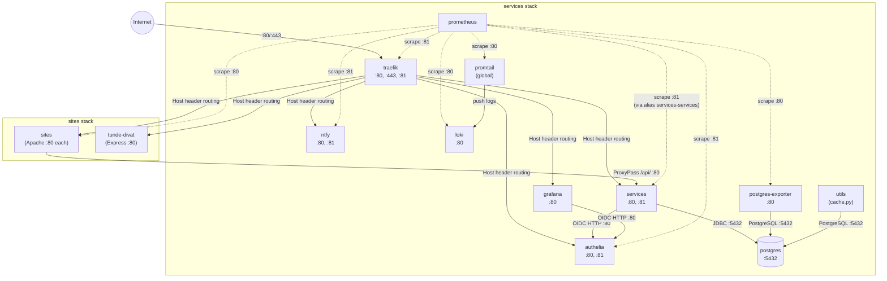

# Networking

## Overlay Networks

Two Docker overlay networks connect containers across both stacks. Both are external and attachable — created once during initial Swarm setup (`deploy.sh --network`):

```yaml
networks:
  edge:
    external: true
  outsideworx:
    external: true
```

```bash
docker network create -d overlay --attachable edge
docker network create -d overlay --attachable outsideworx
```

- **`outsideworx`** — the original shared network. Carries all backend traffic: API proxying (sites → services), JDBC, OIDC, Prometheus scraping of backend services, log shipping. Most services join this network.
- **`edge`** — a second overlay network introduced alongside the `wg-easy` VPN service. It exists to give Traefik, Prometheus, and `wg-easy` a path to each other that doesn't require every lightweight static site to also sit on `outsideworx`. A handful of static sites with no backend dependency (`duckumbrella`, `igli`, `soupkitchen`) were moved onto `edge` instead of `outsideworx`, since Traefik (which routes to them) is reachable there too.

There are no other per-service networks.

### Which Services Are on Which Network

| Service | `outsideworx` | `edge` |
|---------|:---:|:---:|
| authelia | Yes | — |
| grafana | Yes | — |
| loki | Yes | — |
| ntfy | Yes | — |
| postgres | Yes | — |
| postgres-exporter | Yes | — |
| prometheus | Yes | Yes |
| promtail | Yes | — |
| services (Spring Boot) | Yes | — |
| traefik | Yes | Yes |
| utils | Yes | — |
| wg-easy | — | Yes |
| come-in-and-find-out | Yes | — |
| duckumbrella | — | Yes |
| gaiapeeps | Yes | — |
| igli | — | Yes |
| outsideworx (site) | Yes | — |
| soupart | Yes | — |
| soupkitchen | — | Yes |
| tunde-divat | — | — |

Each service joins exactly one of the two networks (`traefik` and `prometheus` are the only services on both). `tunde-divat` currently has no explicit `networks:` entry in `sites/compose.yaml` — this looks like an oversight relative to every other site service (which all declare one of the two networks); verify intent before relying on it reaching Traefik implicitly.

### Why `duckumbrella` / `igli` / `soupkitchen` Moved to `edge`

These are the three static sites with **no** API token and **no** `services_cache` mount (see the sites table in `sites-deployment.md`) — they never need to reach `services_services`, so they have no reason to sit on `outsideworx`. Traefik still routes to them because Traefik itself joins both `edge` and `outsideworx`. The other four static sites (`come-in-and-find-out`, `gaiapeeps`, `outsideworx`, `soupart`) stay on `outsideworx` because they call the API (directly or, for `outsideworx`, as the mirror proxy for ciafo/peeps/soup) or mount `services_cache`.

### Why Prometheus and Traefik Are on `edge`

`wg-easy` is reachable **only** on `edge` (it has no backend dependency and is not part of the API/DB graph). For Traefik to route `vpn.outsideworx.net` to it, and for Prometheus to scrape its `/metrics/prometheus` endpoint, both need a path onto `edge` alongside `wg-easy`. Hence `traefik` and `prometheus` are the two services straddling both networks.

Because the networks are shared within each one, any container can reach any other container on the same network regardless of which stack it belongs to. This enables:
- Traefik (in `services` stack) routing traffic to site containers (in `sites` stack), across whichever of the two networks each site is on
- Site containers on `outsideworx` (in `sites` stack) proxying API requests to the services app (in `services` stack)
- Prometheus (in `services` stack) scraping metrics from the static site containers (in `sites` stack, on whichever network they're on; npm apps expose no metrics) and from `wg-easy` on `edge`

## Swarm VIP DNS (Prod)

Docker Swarm assigns each service a Virtual IP (VIP) and registers it in the overlay network's internal DNS under the format:

```
<stack>_<service>
```

Examples: `services_postgres`, `services_authelia`, `sites_soupart`

This name resolves globally across all nodes in the Swarm — any container on a given overlay network (`outsideworx` or `edge`) can reach any other service on that same network by its VIP DNS name, regardless of which node the target runs on. The two networks are independent namespaces — a service on `edge` only resolves other `edge` services, not `outsideworx` ones, unless it's one of the two services (`traefik`, `prometheus`) that joins both.

## Network Aliases (Java/Spring Boot RFC Compliance)

Java and Spring Boot strictly enforce RFC 3986, which forbids underscores in hostnames. This affects the Spring Boot app in two directions — both when it calls other services and when it receives requests. All aliases exist solely because of this strict compliance; no other service in the stack has this problem.

### Outbound Aliases

The Spring Boot app needs to *call out* to `postgres` (JDBC) and `authelia` (OIDC HTTP). Java's `URI` class rejects the underscore VIP names, so these services have dash-format aliases that the app uses in `application.yaml`:

```yaml
# compose.yaml
authelia:
  networks:
    outsideworx:
      aliases:
        - services-authelia

postgres:
  networks:
    outsideworx:
      aliases:
        - services-postgres
```

### Inbound Alias

The Spring Boot app *receives* scrape requests from Prometheus. Without an alias, Prometheus would target `services_services:81` (VIP DNS), sending `Host: services_services` in the request header. Spring Boot's host header validation rejects the underscore. The alias on the services container itself gives Prometheus a valid hostname to use:

```yaml
# compose.yaml
services:
  networks:
    outsideworx:
      aliases:
        - services-services
```

Prometheus scrape config uses `services-services:81` as the target.

### Why Not Aliases Everywhere?

Aliases are task-scoped in Swarm — they only resolve on the node where the container's task runs. VIP DNS names resolve globally. Using aliases for Promtail (deployed in `global` mode) would break resolution on worker nodes. The underscore format works for everything except Java/Spring Boot's strict RFC compliance.

## Hostname Conventions

| Context | Format | Example |
|---------|--------|---------|
| Prod config referencing a service | `<stack>_<service>` | `services_postgres`, `services_loki` |
| Java code (application.yaml) | `services-<service>` (alias) | `services-postgres`, `services-authelia` |
| Prometheus scraping Spring Boot | `services-services` (alias) | `services-services:81` |
| Test config (Docker Compose) | Short container name | `postgres`, `authelia`, `loki` |
| Test config (host services) | `localhost` or `host.docker.internal` | `localhost:5432`, `host.docker.internal:8081` |

## Test Network (Docker Compose)

In test mode, Docker Compose creates a default bridge network (`services_default`). Containers resolve each other by their `container_name`. The Spring Boot app runs on the host (not in a container), so:

- It reaches PostgreSQL at `localhost:5432` (port exposed to host)
- It reaches Authelia at `https://oauth.localhost` (via Traefik on host port 443)
- Other containers reach the host app at `host.docker.internal:8080`

The sites test stack (`compose-test.yaml`) joins the `services_default` network as external:

```yaml
networks:
  services_default:
    external: true
```

## Service Communication Graph



### Reading the Graph

- **Traefik** is the single ingress point. It terminates TLS and routes to all labeled backend services based on the `Host` header: 4 in the services stack (authelia, grafana, ntfy, services) and all sites in the sites stack (each on its own domain). npm apps are also routed here, to port `80` (their Express server).
- **Sites → services** is an internal connection (Apache `ProxyPass`), not routed through Traefik. The 4 sites provisioned with API tokens (come-in-and-find-out, gaiapeeps, soupart, outsideworx) make these calls. `outsideworx` uses its token when serving the `/clients/<name>` mirror instances of come-in-and-find-out, gaiapeeps, and soupart — their frontend JS calls `/api/`, which the `outsideworx` Apache proxies with `X-Caller-Id: outsideworx`. npm apps make **no** such call — they are self-contained (own Express API + SQLite), never reaching the Spring Boot backend or PostgreSQL.
- **Grafana → authelia** is also internal (OIDC token exchange), not through Traefik.
- **Prometheus** scrapes every service that exposes metrics (prod): services_authelia:81, services_loki:80, services_ntfy:81, services_postgres-exporter:80, services_promtail:80, services-services:81 (alias), services_traefik:81, and the 7 static sites on :80. In test, the 3 statically-scraped sites are targeted (see `monitoring.md`). npm apps are **not** scraped — their `/metrics` (returns `up 1`) is only a health-check endpoint.
- **Promtail** runs in global mode (one instance per Swarm node) and pushes logs from all containers to Loki.

## Detailed Communication Paths

### Prod (Swarm VIP DNS)

| Source | Target | Protocol | Purpose |
|--------|--------|----------|---------|
| services | services-postgres (alias) | JDBC :5432 | Database |
| services | services-authelia (alias) | HTTP :80 | OIDC token, userinfo, JWKS |
| grafana | services_authelia | HTTP :80 | OIDC token, userinfo |
| prometheus | services_authelia | HTTP :81 | Metrics scrape |
| prometheus | services_loki | HTTP :80 | Metrics scrape |
| prometheus | services_ntfy | HTTP :81 | Metrics scrape |
| prometheus | services_postgres-exporter | HTTP :80 | Metrics scrape |
| prometheus | services_promtail | HTTP :80 | Metrics scrape |
| prometheus | services-services (alias) | HTTP :81 | Metrics scrape (actuator) |
| prometheus | services_traefik | HTTP :81 | Metrics scrape |
| prometheus | sites_* | HTTP :80 | Metrics scrape (7 static sites; not tunde-divat) |
| promtail | services_loki | HTTP :80 | Log push (`/loki/api/v1/push`) |
| postgres-exporter | services_postgres | PostgreSQL :5432 | DB metrics |
| utils (cache.py) | services_postgres | PostgreSQL :5432 | Image sync |
| sites (Apache) | services_services | HTTP :80 | API proxy (`/api/`) |
| traefik | sites_tunde-divat | HTTP :80 | Reverse proxy routing (Express app) |
| traefik | all labeled services | HTTP :80 | Reverse proxy routing |

### Test (Docker Compose Short Names)

| Source | Target | Protocol | Purpose |
|--------|--------|----------|---------|
| services (host) | localhost | JDBC :5432 | Database |
| services (host) | oauth.localhost (via Traefik) | HTTPS :443 | OIDC (browser redirects) |
| services (host) | oauth.localhost (via Traefik) | HTTPS :443 | OIDC token/userinfo/JWKS |
| grafana | authelia | HTTP :80 | OIDC token, userinfo |
| prometheus | authelia | HTTP :81 | Metrics scrape |
| prometheus | loki | HTTP :80 | Metrics scrape |
| prometheus | ntfy | HTTP :81 | Metrics scrape |
| prometheus | postgres-exporter | HTTP :80 | Metrics scrape |
| prometheus | promtail | HTTP :80 | Metrics scrape |
| prometheus | host.docker.internal | HTTP :8081 | Metrics scrape (services on host) |
| prometheus | sites (short names) | HTTP :80 | Metrics scrape (come-in-and-find-out, gaiapeeps, soupart) |
| promtail | loki | HTTP :80 | Log push |
| postgres-exporter | postgres | PostgreSQL :5432 | DB metrics |
| utils (cache.py) | postgres | PostgreSQL :5432 | Image sync |
| sites (Apache) | host.docker.internal | HTTP :8080 | API proxy (`/api/`) |

## Port Conventions

| Port | Used for |
|------|----------|
| 80 | Default HTTP — business traffic and metrics on some services (loki, postgres-exporter, promtail, all sites) |
| 81 | Dedicated metrics/actuator (authelia, ntfy, services, traefik) |
| 443 | HTTPS (Traefik only) |
| 5432 | PostgreSQL |
| 8080 | Spring Boot app in test mode (on host) |
| 8081 | Spring Boot actuator in test mode (on host) |

## Key Rules

1. **Never use short names in prod configs** — always `<stack>_<service>` format
2. **Never use `services_` prefix in test configs** — always short container names
3. **Only add network aliases when Java/Spring Boot is involved** — outbound (`authelia`, `postgres`) or inbound (`services` itself)
4. **Aliases are task-scoped** — they only resolve on the node where the container's task runs, not across the Swarm. This means `authelia`, `postgres`, and `services` must all run on the same node — the Spring Boot app uses aliases to reach them, and those aliases won't resolve if the targets are scheduled on a different machine.
5. **Two flat overlay networks, no per-service networks** — `outsideworx` for backend-connected services, `edge` for Traefik/Prometheus/wg-easy and the three backend-free static sites. A service picks exactly one network unless it needs to straddle both (currently only `traefik` and `prometheus`).
